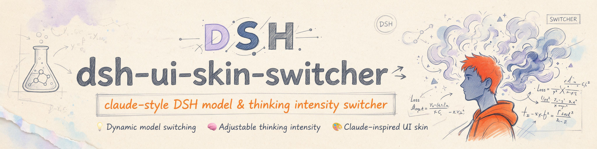

<h1 align="center">@domitor-syh/dsh-ui-skin-switcher</h1>

<p align="center">
  
</p>

<p align="center"><a href="./README.md">中文</a> | English</p>

<p align="center">
  <a href="https://awesome-dsh-plugin.com"></a>
  <a href="https://awesome-dsh-plugin.com"></a>
  <a href="https://www.npmjs.com/package/@domitor-syh/dsh-ui-skin-switcher"></a>
  <a href="https://www.npmjs.com/package/@domitor-syh/dsh-ui-skin-switcher"></a>
  <a href="./LICENSE"></a>
  <a href="https://github.com/domitor-syh/dsh-ui-skin-switcher/actions/workflows/ci.yml"></a>
</p>

A **Claude Desktop-style switcher** for the [DeepSeek Harness](https://github.com/deepseek-ai/deepseek-harness) (DSH) Web GUI: change the model or dial reasoning effort without ever leaving the composer.

## What it is

A **model and reasoning-effort switcher** floating next to the input box: open the dropdown to pick a model, drag the slider to dial reasoning effort — your choice takes effect on the current session right away.

Models are grouped by vendor with a checkmark on the active one, effort levels follow whatever the model itself supports, and each model remembers the level you last picked.

The style pays homage to Claude Desktop's switcher — slider feel, rounded track, hover highlight.

## Features

| Feature | Detail |
| --- | --- |
| Model switching | Clicking the model entry expands the model list ordered by vendor; the selection applies immediately and the matching reasoning effort updates together |
| Effort slider | Supports both click and drag, with multiple effort nodes; supported levels differ per model, and adjustments apply immediately |
| Max-effort dot matrix | Reaching max effort reveals a right-to-left dot-matrix sweep on the track, with the handle glowing |
| Per-model memory | Remembers the last effort per model, kept across switches |
| Theme adaptive | All colors bound to DSH theme tokens; readable in light/dark themes and transparent skins |

## Video preview

<p align="center">
  <video src="https://github.com/user-attachments/assets/e2905bda-0e42-4f56-a3a0-7a545b958b03" controls muted loop playsinline width="100%"></video>
</p>

> **The inline player needs a GitHub sign-in** and cannot play while signed out; in that case click the **link below** to watch in a new tab.

**▶︎ [Watch the full demo video](https://cdn.jsdelivr.net/gh/domitor-syh/dsh-ui-skin-switcher@main/docs/dsh-ui-skin-switcher-demo.mp4)** — model switching, the effort slider, and the top-level dot-matrix animation.

## Install

**Web** (`dsh web`):

```sh
dsh plugin --profile web add @domitor-syh/dsh-ui-skin-switcher
```

**Desktop** (official channel) — enter the package name **`@domitor-syh/dsh-ui-skin-switcher`** in the plugin installer, or use the equivalent command:

```sh
dsh plugin --profile desktop add @domitor-syh/dsh-ui-skin-switcher
```

After installing: on Web, restart `dsh web` and refresh the page; on Desktop, restart the app. When running DSH from source, prefix the commands above with `pnpm`.

The current adaptation target is **DSH 0.2.0-rc.2**. The declared compatibility range is `>=0.1.5-alpha.1`; other builds need their compatibility confirmed.

## Usage

1. **Pick a model** — click the button and pick from the list; the list is grouped by vendor and the current model shows a checkmark.
2. **Dial effort** — for models declaring `reasoningEfforts`, an effort button appears to the right of the model; click it, then drag the slider or tap the track to switch levels.

### Why is there no reasoning-effort switcher after adding a model?

The current model does not declare a reasoning effort (`reasoningEfforts`) or vision capability. To keep model declarations accurate, we do not apply a uniform effort preset to every model — check the model vendor's official documentation and patch the underlying config file yourself, or hand the vendor's deep-thinking documentation (or its link) to the LLM and let it modify the config directly.

> Taking effect: you edit `settings.yaml` under the DSH home (`~/.dsh`) — **not this plugin's files**; DSH watches that file and hot-reloads, so the change takes effect **immediately with no restart** and persists across restarts.

Why do it yourself? To keep declarations accurate — **accuracy over coverage**. Reasoning effort is a per-vendor, per-level wire value; a wrong value silently breaks requests, so we never fill in a guessed preset.

## License

[MIT](./LICENSE)